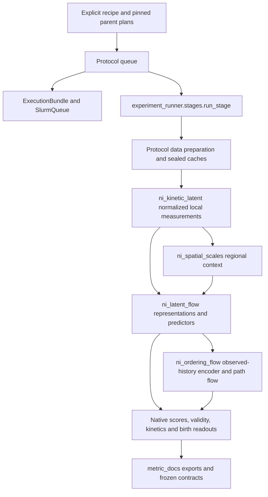

# Active Ni code: architecture and maintainability review

Reviewed on 2026-10-23 against `cdafa639` (2026-10-20), following
`5c0da4c5` (2026-10-13) and `05e3e8ca` (2026-10-11). These commits introduce
the active Ni trajectory, ordering, measurement and kinetic workflows.
This is a focused review of those paths and their actual dependencies, not a
repository-wide retirement audit or a statement of experiment completion.
Existing edits to the phase-measurement research documentation were excluded.

## Entry points and ownership

Commands below run as `python -m MODULE STAGE --config CONFIG`. Inspect the
recorded launch receipts before using a launch stage; this review launches no
scientific jobs. Stage choices remain available through `--help`.

| Workflow | Module under `src.research` | Recipe under `configs/ni_latent_sim` | Main responsibility |
| --- | --- | --- | --- |
| Latest ordering/history comparison | `ni_ordering_flow.queue` | `ordering_20261019.json` | Extend observed history, jointly train its encoder and path flow, assess native paths, rare entry, teachers and births. |
| Expanded validation | `ni_latent_flow.queue` | `validation_20261018.json` | Reuse/expand native observations; representation and conditioning diagnostics, support-constrained direct trajectories. `workflow: validation` selects its task list. |
| Native trajectory comparison | `ni_latent_flow.queue` | `flow_20261018.json` | Fixed representations, joint block flows and finite-history mixture transitions, native and birth assessments. |
| Regional context comparison | `ni_spatial_scales.queue` | `spatial_scales_20261015.json` | Measure complete-ball context; adapt the existing kinetic trainer and assessor. |
| Kinetic representations | `ni_kinetic_latent.queue` | `kinetic_latent_20261015.json` | Normalize measured states; fit representations and stochastic latent dynamics; supply shared diagnostics. |
| Earlier phase/measurement controls | `ni_phase_sim.history`, `ni_phase_sim.measurement_queue` | `phase_history_20261013.json`, `phase_measurements_20261014.json` | Physical history and measurement teachers reused by subsequent protocols. |

The separate simulation entry point
`src.simulation.campaigns.ni_ordering_branches` uses
`configs/simulation/ni_ordering_branches_20261019.json`. It shares subprocess
execution, but its physical branches are not model training data by implication.

## Trace through the active paths

**Data and preprocessing.** Protocol `data.py` files resolve pinned parent plans,
verify identities/checksums, and expose concrete dictionaries to their callers.
`continuous_motion.data.Source` reads native positions/velocities and checks
atom identities; `measurement_sim.features` produces structural and smooth
measurements. `ni_kinetic_latent.data` owns the affine/asinh/affine transform
and inverse. Its normalization fits in float64 on train observations, then
stores float32 buffers. It does not clip excursions. The central channel order
is fixed: 40 bond-order, 113 topology, 74 density and 17 velocity coordinates.

The native bank's `x` is `[N,64,244]`: four observed 0.1-ps frames followed by
60 future frames. It also carries `rows`, `columns`, `train_rows`, `test_rows`,
four normalization tensors, active channels and group weights. Regional caches
contain `[N,64,3,87]` native and `[Nb,4,3,87]` birth values for 8/12/20 Å radii.
An arm selects one radius to form 331 input coordinates; targets remain 244.
The validation expansion preserves the reference normalizer and original ancestry.

Ordering reuses this bank and prepares `[N,13,331]` observed histories in
`ni_ordering_flow.data`. Its local four-frame baseline can train before extended
histories finish. Regional normalization uses train histories only. History
availability, exact offsets and central identities remain scientific checks.
The birth-history neighbor convention differs from earlier frozen histories;
these are distinct producers, not interchangeable cache layouts.

**Models and training.** `ni_kinetic_latent.model` owns representation encoders,
decoders, VAMP scoring and mixture transitions. The spatial trainer supplies
a 331-input model and data adapter to its shared training implementation.
`ni_latent_flow.representation` attaches the SelfTICA/FMRC objective heads.
`ni_latent_flow.model` owns `BlockFlow` and `MemoryTransition`; its composite
encoder/predictor `Model` currently lives in `learning.py`.

Latent-flow training explicitly stages representation, decoder and dynamics
optimization, or reuses a pinned representation. Ordering instead jointly trains
an observed-history attention encoder and a measured-state block flow. Its
optional dense teacher head receives the 91 smooth coordinates; response
supervision differentiates that head through the same train-fitted transform.
These trainers have different RNG, optimizer and EMA checkpoint contracts and
should not be merged simply because their loops look alike. Training budgets
and final-checkpoint rules are frozen; test scores are not selectors.

**Evaluation.** `ni_kinetic_latent.assessment` supplies path scores, source-level
aggregation and diagnostics. Spatial and latent-flow assessment adapt it via
explicit loader/model providers. Latent flow adds validity accounting;
`diagnostics.py` and `kinetics.py` run the validation readouts. Ordering evaluates
the longer history, rare-entry panel, dense response and generated birth features.
Birth readouts reuse `ni_kinetic_latent.births`. Metrics flow through
`experiment_runner.metric_docs`; associated summaries update recorded W&B runs.
Diagnostic probes stay local. Native MD evaluation, short NVE teacher evaluation
and the separate birth assay retain different scientific meanings.

**Execution and provenance.** Queue modules own scientific prerequisites,
resource choices, global deadlines and continuations. `ExecutionBundle` freezes
source/config; `SlurmQueue` submits explicit commands. `run_stage` now owns
locking, subprocess attempts, logs and bounded deadline termination. The queue
supplies a resolved output path, module, arm name and retry budget explicitly.
No research configuration or dataset loader is imported by that module.
`complete.json`, failed-stage markers, exit 75, checkpoints and per-attempt
receipts retain their existing meaning.

## Prioritized problems and recommended simplifications

| Priority | Concrete problem and affected files | Action and trade-off |
| --- | --- | --- |
| 1 | Six research entry points and the ordering simulation imported subprocess execution from `ni_phase_sim/history.py`. Execution depended on an older scientific workflow and its import graph. | **Implemented:** move the existing mechanism to `experiment_runner/stages.py`; update all nine live call sites. Keep task dependency rules in their queues. This is a function relocation, not a new workflow framework. |
| 2 | `ni_latent_flow/model.py` and `ni_ordering_flow/model.py` duplicated the Euler integration grid and update. A correction could otherwise reach only one predictor. | **Implemented:** one inherited `BlockFlow._integrate`. Callers still own context, RNG, initial dtype and output slicing, which differ intentionally. |
| 3 | `ni_spatial_scales/data.py::_regional_transform` duplicated `ni_kinetic_latent/data.py::transform` even though that function was already imported. | **Implemented:** use the existing transform. Preserve fitting, broadcast dimensions, sample SD, floors, active mask, and serialized keys. |
| 4 | Path/JSON/hash helpers are re-exported through several experiment `data.py` modules; the shared environment comes through `ni_phase_sim/campaign.py` and `measurement_sim/workflow.py`. Importing execution/data helpers can load unrelated geometry libraries. | **Next:** use existing `experiment_runner.artifacts` and `project_runtime.paths` directly where contracts match, and move the environment builder to execution support. Preserve cached resolution, serialization options and PATH ordering. Avoid creating another generic `utils` module. Risk: medium because file hashes and environment order affect reproducibility. |
| 5 | `ni_latent_flow/learning.py::Model` mixes model composition with training orchestration; diagnostics import training code to construct/load a predictor. | **Proposed:** move the composite model beside `BlockFlow`; keep fitting and checkpoint I/O in `learning.py`. Retain its import name where required and prove strict old-state loading. Benefit: inference has a clear starting point. Risk: medium until archived object serialization and all factory callers are audited. Not implemented here. |
| 6 | `ni_latent_flow/data.py`, `expansion.py` and `ni_ordering_flow/data.py` communicate via mutable dictionary keys and repeated 244/331/64/87 offsets. Configured arms repeat dimensions and budgets across large JSON files. | **Proposed:** document the concrete producer schema at the loaders and centralize measurement slices beside their producer. Continue freezing fully expanded recipes. Do not introduce a dataset hierarchy or runtime config inheritance. Risk: medium: ordering, local and regional inputs have genuinely different support. |
| 7 | Queue loops repeat task scanning and completion logic; assessment modules import private functions from earlier experiments. Source-wide hashes also couple operational edits to metric contracts. | Consolidate only another proven identical operation when extending a workflow. Prefer named score functions and explicit provider arguments; keep scientific panels and retry policies visible. A generic DAG engine or universal trainer would add more concepts than it removes at present. |

Two apparent duplicates are deliberately retained. The original
`ni_latent_flow.assessment._bounds` and validation `support.bounds` have different
recorded bounds (including neighbor SD, topology and cross-radial density).
`ni_phase_sim.campaign.stage` also records different state fields and clears
CUDA caches at a different point than the relocated history executor. Neither
was silently replaced. No model family or experimental branch was declared dead.

## Implemented scope and compatibility

The patch changes execution ownership, shares the flow integrator and removes
the duplicate transform. The research index links this map and the previously
unlisted ordering workflow. No recipe, training objective, model parameter,
buffer name, optimizer rule, split, label, tensor layout or saved result changes.
Current imports, module commands, configuration references and callers were
searched before removing the old internal function bodies; frozen source copies
remain the reproduction path for historical runs.

Seven current Ni metric families bind the reviewed source changes and the new
stage module in `docs/metrics/contracts.json`. Mathematical definitions did not
change. Historical exported contracts and tables remain untouched. As before,
an export under changed implementation hashes needs a new analysis revision;
the current source must not relabel old results or bypass frozen plan checks.

## Verification and limits

Disposable integration evidence is under
`output/maintenance/active-ni-20261023/technical/` (`check_refactor.py`,
`before.json`, `after.json`, serialized baselines and command logs).
The environment is conda `pointnet-torch214`, PyTorch `2.14.0+cu130`, CPU only,
one CPU thread, and the launcher's `TORCH_FORCE_NO_WEIGHTS_ONLY_LOAD=1` setting.

- Nine configured model variants: ordinary/noisy block flows plus all seven
  ordering treatments. One local optimizer update, loss/gradients, optimizer
  state, model state and RNG state agree exactly before/after. Seeded stochastic
  and deterministic `[2,3,60,244]` sampling agrees exactly in FP32 and CPU BF16
  autocast. Pre-refactor state dictionaries load strictly after the change.
- Real regional assembly over small synthetic sealed source packets exercises
  train/test separation, constant channels, three radii, birth inputs, checksum
  checks and cached re-entry. Both transformed arrays and fitted buffers agree
  exactly. No real dataset is recollected or renormalized.
- Eleven real subprocess scenarios agree before/after: successful completion,
  retry then success, exhausted failure, missing completion marker, pause,
  hard deadline, held lock, existing completion/failure, custom cache folder,
  and the original soft-deadline mode. Commands, attempt counts, exit codes and
  receipt fields match. Processes are created only for these checks.
- All seven affected CLI entry points accept `--help`; changed Python compiles.
  All seven affected Ni metric families pass `check_metric_docs`.
- The full `scripts/experiment_registry.py metrics-docs` audit remains blocked
  by pre-existing mismatches outside these families. See
  `all-metric-contracts.log`. These unrelated hashes were not reapproved.

No GPU execution, Slurm submission, full scientific training, dense teacher JVP
training or production-scale evaluation was performed. CPU exactness does not
certify CUDA kernel equivalence or throughput. The next validation opportunity
is a small GPU replay under an existing authorized allocation, followed by the
normal frozen-source checks for the next scientific experiment. Resolve unrelated
metric-contract drift through a separate producer/definition review before
claiming a clean repository-wide audit.
